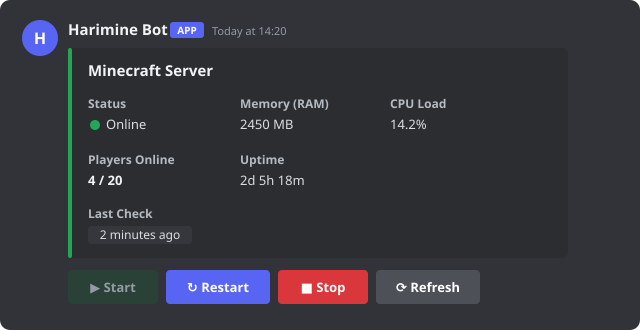
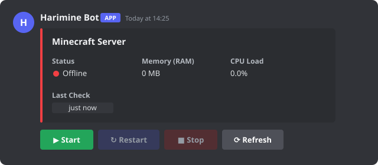
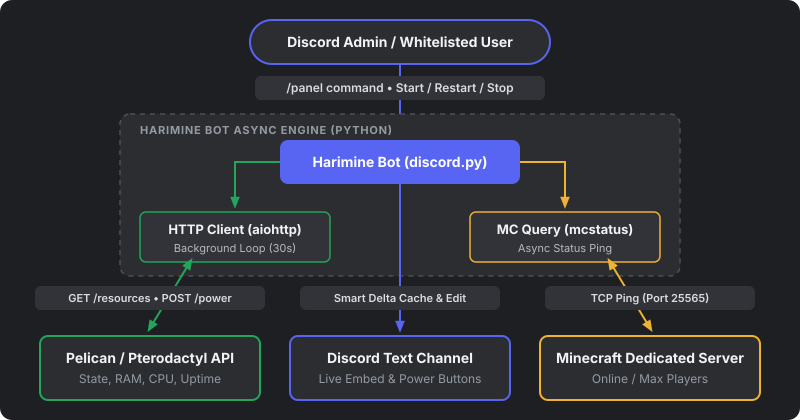

# 🎮 Harimine Bot — Minecraft Server Control Panel for Discord

Real-time Discord control panel for Minecraft servers running on **Pelican** or **Pterodactyl**. Features live status embeds, server uptime, player counter, and state-aware power buttons (`Start` / `Restart` / `Stop`) with strict role-based access control.

---

## 🖼️ Panel Previews

  
  

  <em><b>Online State:</b> Start disabled, Restart &amp; Stop active &nbsp;|&nbsp; <b>Offline State:</b> Start active, Restart &amp; Stop disabled</em>

---

## 🏗️ Architecture & Data Flow

  

---

## 🧩 Supported Control Panels

Built on the standard Pterodactyl/Pelican `Client API`, working out of the box with:
* **Pelican Panel**
* **Pterodactyl Panel** (v1.x)
* **Jexactyl**
* **Pyrodactyl**
* **WISP** and other Pterodactyl-compatible forks

## ✨ Key Features

* **Live Status Embed:** Displays real-time server state (`Online`, `Starting`, `Stopping`, `Offline`), RAM usage, CPU load, and server **Uptime**.
* **Privacy-Friendly Player Counter:** Queries active and maximum player counts via `mcstatus` without exposing player nicknames.
* **State-Aware Power Buttons:** Interactive **Start**, **Restart**, **Stop**, and **Refresh** buttons that automatically enable or disable based on the current server state.
* **Rate-Limit Friendly Caching:** Edits the Discord message only when meaningful changes occur (configurable RAM/CPU step thresholds) or once every 5 minutes.
* **Persistent State:** Remembers the panel channel and message ID across service restarts (`panel_state.json`).
* **Strict Access Control:** Restricts power actions and panel creation to Discord server administrators and whitelisted user IDs (`ALLOWED_USERS`).

---

## ⚡ One-Line Installation (Linux / systemd)

> 📖 **Need help creating a Discord bot or getting API keys?** Check out the step-by-step guide in **[SETUP.md](SETUP.md)**.

Run the following command on your Linux server:

~~~bash
curl -fsSL https://raw.githubusercontent.com/haribulus/harimine-bot/main/install_service.sh | bash
~~~

**What the installer does:**
1. Clones the repository into `/opt/harimine-bot` (or a custom directory of your choice).
2. Launches an interactive configuration wizard to prompt for your Discord token, Panel URL, Client API key, server address, and admin Discord IDs.
3. Generates a secured `config.py` (`chmod 600`).
4. Creates an isolated Python `venv`, installs dependencies, and registers/starts the `harimine-bot.service` systemd unit.

Once running, open your desired Discord channel and run the `/panel` slash command.

---

## 📦 Manual Installation (via Git)

~~~bash
git clone https://github.com/haribulus/harimine-bot.git
cd harimine-bot
./install_service.sh
~~~

---

## 🛠 Service Management

* **Check status:** `sudo systemctl status harimine-bot`
* **View live logs:** `journalctl -u harimine-bot -f`
* **Restart bot:** `sudo systemctl restart harimine-bot`
* **Reconfigure settings:** `/opt/harimine-bot/install_service.sh` (or edit `/opt/harimine-bot/config.py`)
* **Stop bot:** `sudo systemctl stop harimine-bot`
* **Uninstall service:** `/opt/harimine-bot/uninstall.sh`

---

## 📄 License

Licensed under the **GNU General Public License v3.0 (GPLv3)**. See [LICENSE](LICENSE) for full details.
